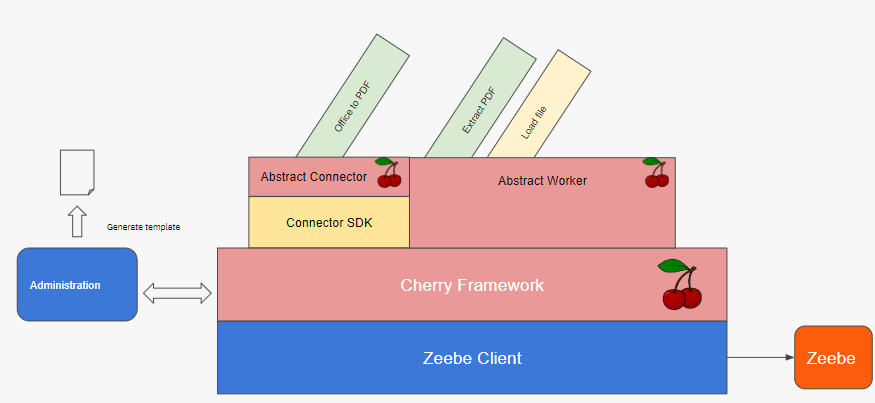
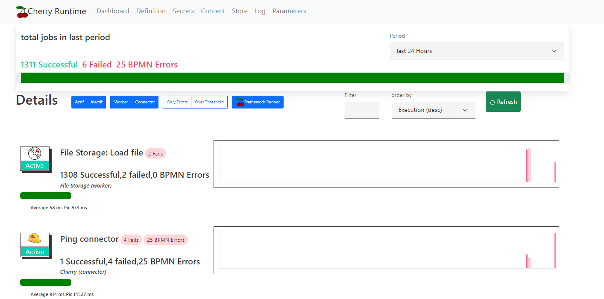
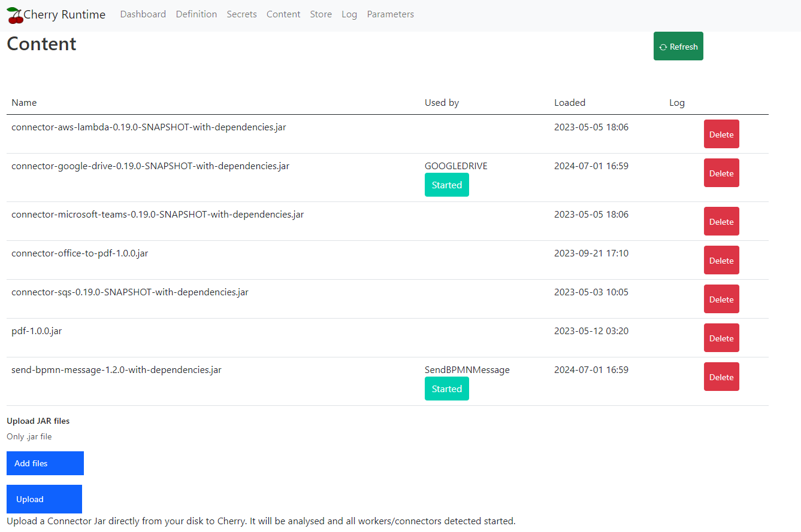
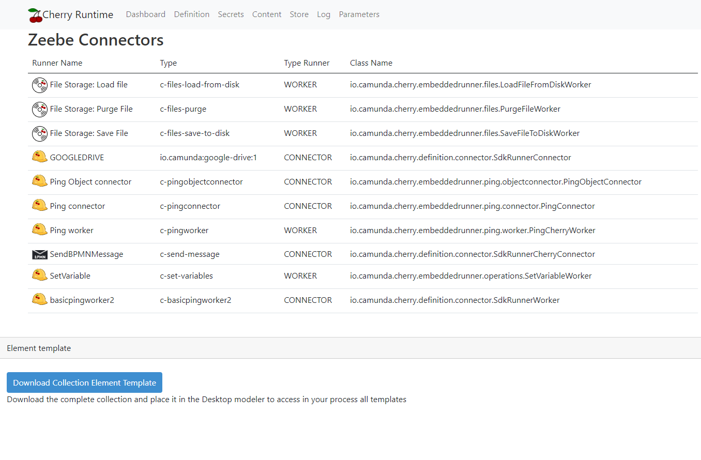
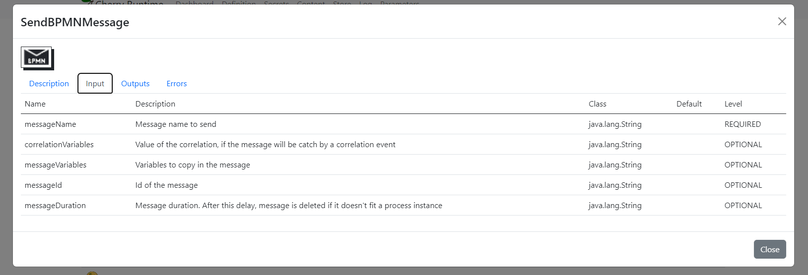
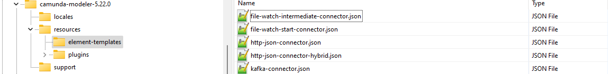

[](https://github.com/Camunda-Community-Hub/community/blob/main/extension-lifecycle.md#incubating-)
[](https://github.com/camunda-community-hub/community)


# What is the Cherry Runtime?

The Cherry Runtime is dedicated to executing Camunda 8 Connectors and Workers.

It provides
* Administrative pages
  * to monitor the activity of connectors/workers: speed, number of executions
  * To stop/restart the execution

* A connector / worker can be uploaded
  * From the UI,
  * From a shared folder
  * Download it from the marketplace, the CamundaCommunityHub, the CamundaRuntime store, or a private GitHub repository

* Element template can be downloaded

* A farm of runtime, all are managed from one single page

* For developpers, a library is available to generate element-templates for Connectors and Workers



The Cherry runtime accepts any OUTBOUND connector.


This documentation gives information:
* for administrators to start and administrate connector
* for BPM Designer, to access documentation and download Element-Template in your modeler
* For developers, which information can be added during the development, to propose more information for administrators and BPM Designer


# Installation


## Download the application

Download the Docker Image, or use the docker-compose given in the [docker-Cherry](docker/README.md)
The image is available here.

```
ghcr.io/camunda-community-hub/zeebe-cherry-runtime:latest
````

## Configure the application

Cherry needs:
* to connect to Zeebe to get jobs
* to save connectors and statistics

Check the [application.yaml](src/main/resources/application.yaml) file to see all parameters.

The connection use this approach https://github.com/camunda-community-hub/spring-zeebe?tab=readme-ov-file#configuring-camunda-8-connection

### Saas
Use
```yaml
camunda:
  client:
    mode: saas
    auth:
      client-id: <your client id>
      client-secret: <your client secret>
    cluster-id: <your cluster id>
    region: <your cluster region>
```

### Self-manage without Identity

```yaml
camunda:
  client:
    mode: simple
    auth:
      username: demo
      password: demo
    zeebe:
      enabled: true
      gateway-url: http://localhost:26500
      base-url: http://localhost:8080
      prefer-rest-over-grpc: false
```

### Self-manage with Identity

````yaml
camunda:
  client:
    mode: oidc
    auth:
      client-id: <your client id>
      client-secret: <your client secret>
    zeebe:
      enabled: true
      gateway-url: http://localhost:26500
      base-url: http://localhost:8080
      prefer-rest-over-grpc: false
````

### Use parameters
It is possible to pass parameters as a variable, for example.

``
Environment:
- CAMUNDA_CLIENT_MODE=saas
  ``
  To connect a local engine in the same cluster.


# Database

An H2 database is configured by default to save information. Use a SQL database for a robust database.
Looks [docker-compose-cherry-postgres.yaml](docker/docker-compose-cherry-postgres.yaml) to see an example.

Using an SQL database allows you to configure one Cherry pod and a farm of pods. Each pod accesses the same database, and statistics are shared between all pots through connectors.

# Store

A store is a container which contains connector or worker. The runtime access the store and is able to download new connectors/worker from store.

A store can be the official Camunda connectors repository, the Camunda Community Hub, the Camunda Marketplace, or a private GitHub repository.
Each store and its parameters is described in the following sections.
It's possible to ask to download connectors/workers at startup, via configuration. Then starting the runtime downloads the JAR, and starts the connector. It saves the connector to the local database.
Other usage is to list all available connectors/workers in the "Store" page, then via a click, the user can download one on demand.


## Connector runtime

This store explores the official Camunda connectors repository, https://github.com/camunda/connectors, at its latest GitHub release tag. 
It recursively scans the repository's `connectors` folder, and considers a folder to be a connector as soon as it has an `element-templates` subfolder:
* if that folder also has a `pom.xml`, the connector has its own implementation (a JAR to download)
* if it has no `pom.xml`, the connector has no implementation of its own - it relies on another connector already present (for example a connector built on top of the generic REST connector)

Unlike the Community hub store below, a connector found here is only ever looked up as a Maven artifact - never as a GitHub release asset. Its `pom.xml` is read to get groupId/artifactId/version, and the JAR is searched on Maven Central (`https://repo.maven.apache.org/maven2`); if the exact release version isn't published yet, earlier patch versions are tried as a fallback.

Configuration, under `cherry.store.camundaConnector`:
* `access`: enables/disables this store
* `github.token`: optional - not needed to access this public repository, it only raises GitHub's API rate limit (60 req/h unauthenticated -> 5000 req/h authenticated). A plain personal access token generated from any GitHub account works fine, no special scope or org membership needed, since this only reads a public repository.
* `maven.token` / `maven.apikey`: not needed either - the JAR is always downloaded from Maven Central, which is a fully public, unauthenticated repository.
* `startup`: see `downloadPolicy`/`filter` explained once at the end of this chapter, under [Private store](#private-store) - every store shares the same `startup` structure.

Example
```yaml
    camundaConnector:
      access: false
      # Optional: only raises the GitHub API rate limit, not required for access.
      github:
        token: ""
      # Not needed: the JAR always comes from Maven Central, which is public.
      maven:
        token: ""
        apikey: ""
      startup:
        # NEVER, ALWAYS, UPDATE,FIXEDVERSION
        downloadPolicy: NEVER
        filter:
          - "CSV*"
```
> Note: github token.


## Community hub connector

This store explores every repository under the `camunda-community-hub` GitHub organization (https://github.com/orgs/camunda-community-hub), optionally narrowed down by `filterProject` (a name pattern, for example `connector-8*` keeps only repositories whose name matches it).

A repository is recognized as a connector/worker as soon as it has at least one of:
* an `element-templates` folder containing at least one template,
* a GitHub release,
* a `pom.xml` at its root.

Once a repository is recognized, Cherry looks for its JAR in this order, stopping at the first one that has it:
1. as an asset attached to the repository's latest GitHub release,
2. on Maven Central, if the `pom.xml` could be read (its groupId/artifactId/version are searched there),
3. on Camunda's own JFrog Artifactory (https://artifacts.camunda.com), using the same groupId/artifactId/version.

Note: the repository actually holding a given connector's Maven artifacts is declared in that connector's own `pom.xml` (its `<distributionManagement>`/`<repository>`); Cherry currently searches a single, fixed Artifactory repository (`camunda-bpm-community-extensions`) for step 3, so a connector deployed to a different Artifactory repository won't be found there.

Configuration, under `cherry.store.communityConnector`:
* `access`: enables/disables this store
* `filterProject`: name pattern applied to repositories in the org (`*` as a wildcard)
* `github.token`: optional, but this is the store that benefits from it the most, since it lists every repository in the whole org - without it, GitHub's API limits requests to 60/h; with a token, 5000/h. Generate one at https://github.com/settings/tokens, no scopes are needed for public repositories.
* `maven.access`: enables/disables step 2 (Maven Central search) independently of the rest of the store
* `maven.token` / `maven.apikey`: credentials for step 2. Left empty by default since Maven Central is public.
* `jfrog.access`: enables/disables step 3 (Camunda's Artifactory) independently of the rest of the store
* `jfrog.token` / `jfrog.apikey`: credentials for step 3. Camunda's Artifactory is gated behind Camunda SSO - generate either one from your JFrog profile (top-right avatar -> Edit Profile): an Identity Token, sent as `Authorization: Bearer <token>`, or an API Key, sent as `X-JFrog-Art-Api: <apikey>`. Only one of the two is needed. See https://artifacts.camunda.com/ui/packages to browse what's published there.
* `startup`: see `downloadPolicy`/`filter` explained under [Private store](#private-store).

Example
```yaml
    communityConnector:
      access: true
      filterProject: connector-8*

      # Optional GitHub token to avoid API rate limiting (60 req/h unauthenticated ->
      # 5000 req/h authenticated) - this store lists every repository under the org, so
      # it benefits the most. Generate at https://github.com/settings/tokens (no scopes
      # needed for public repos).
      github:
        token: ""

      # Access to Maven Central, used when a connector's pom.xml points to it.
      # Maven Central is public, so these are normally left empty.
      maven:
        access: true
        token: ""
        apikey: ""

      # Access to Camunda's own JFrog Artifactory (artifacts.camunda.com), tried when the
      # jar isn't found on Maven Central either.
      jfrog:
        access: true
        token: ""
        apikey: ""

      startup:
        # NEVER, ALWAYS, UPDATE,FIXEDVERSION
        downloadPolicy: ALWAYS
        filter:
          - "*Kpi*"
          - "camunda-8-connector-pdf"
```

## Marketplace

This store explores the public listing of https://marketplace.camunda.com (an unauthenticated call - no credentials are involved for this part). For every app listed there, it fetches that app's own marketplace page and looks for a "Host Yourself"/"For SM" button, whose link points to a GitHub repository.

If that GitHub repository belongs to `camunda-community-hub` or to `camunda/connectors`, the entry is dropped - it's already covered by the two stores above, so this avoids listing the same connector twice. Otherwise, the GitHub repository found this way is used to fetch the connector's element-template, using `github.token` below if one is configured.

Current limitation: downloading a connector through this store isn't implemented yet. Marketplace entries can be listed and explored (icon, description, creator, element-template), but not installed from here - `maven.token`/`maven.apikey` are accepted in the configuration already, reserved for when that download path is implemented.

Example
```yaml
    marketplaceConnector:
      access: false
      # Only used to fetch element-templates from the marketplace entry's own GitHub repo.
      github:
        token: ""
      # Not used yet - downloading a connector from the Marketplace isn't implemented.
      maven:
        token: ""
        apikey: ""
```


## Private store

`access` enables/disables the private-store mechanism as a whole. When enabled, `listStores` is a list of arbitrary GitHub profiles, organizations, or repositories to explore - each entry works exactly like the Community hub store above (same connector-detection rules, same GitHub-release-then-Maven JAR lookup order), but is independently configured:

* `name`: this store's display name - also the name used to refer to it elsewhere (see [Direct download](#direct-download) below). Defaults to the last path segment of `url` when left empty.
* `url`: the GitHub profile/org/repository URL to explore (for example `https://github.com/<user>`).
* `github.token` / `github.apikey`: a single credential used for two purposes at once - this store's GitHub API access (listing repositories, releases, element-templates) **and** the credential for this store's own Maven provider (searching/downloading a JAR). Nested under `github`, like every other store's GitHub credential. Leave both empty for a fully public GitHub account and a public Maven repository.
* `tokenHeaderName` / `tokenPrefix`: override the HTTP header name/prefix used when sending `github.token` to the Maven provider. Default to `Authorization` / `Bearer ` (the standard Bearer-token scheme) - only change these if a given private Maven repository expects something different.
* `apikeyHeaderName`: override the HTTP header name used when sending `github.apikey` to the Maven provider. Defaults to `X-JFrog-Art-Api` (JFrog Artifactory's own scheme) - only change it for a non-JFrog repository with its own API-key header.
* `startup`: controls automatic downloads when the runtime starts:
  * `downloadPolicy`: `NEVER` (do nothing at startup), `ALWAYS` (download every matching connector every time, even if already present), `UPDATE` (download only if a newer release is available than what's already installed), or `FIXEDVERSION` (download once if missing, but never again after that, even if a new release appears).
  * `filter`: a list of name patterns (`*` as a wildcard) - only connectors/repositories whose name matches one of them are downloaded at startup.

Example
```yaml
    privateStore:
      access: true
      listStores:
        - name: pierre-yves
          url: https://github.com/pierre-yves-monnet
          github:
            token: ""
            apikey: ""
          tokenHeaderName: "Authorization"
          tokenPrefix: "Bearer "
          apikeyHeaderName: ""
          startup:
            # NEVER, ALWAYS, UPDATE,FIXEDVERSION
            downloadPolicy: ALWAYS
            filter:
              - "C8-MathWorker"
```

## Direct download

A direct download is a different, ad-hoc mechanism to download one exact JAR URL at startup, independent of any store's own exploration/filtering logic. Each entry still needs a store to borrow its security credentials from (`store`), looked up by that store's own name - one of `"Camunda Connector"`, `"Camunda Community Hub"`, `"Marketplace"`, or one of the `privateStore.listStores` entries' own `name`.

```yaml
  store:
    # Startup downloads for connectors: each entry is a direct JAR URL, downloaded using the
    # named store's own credentials (store must be a name known to StoreFactory, e.g. a
    # privateStore entry's "name").
    downloadStartup:
     - store: pierre-yves
       url: "https://github.com/pierre-yves-monnet/camunda-complexvariable-c8"

```


# Folder upload

Any JAR file placed in the folder configured by `cherry.connectorslib.uploadpath` (default `./localstorage/upload`) is picked up automatically: at startup, Cherry scans that folder (top level only, no sub-folders) for `.jar` files, then for each one it installs it (saves it to the database, so it survives a restart without needing the file again) and starts every connector/worker it contains. A release version is guessed from the file name itself by looking for a `X.Y.Z` pattern (for example `connector-pdf-3.3.2.jar` → release `3.3.2`); if none is found, the connector is installed without a known release.

This detection only happens once, when the application starts - dropping a new JAR into the folder while Cherry is already running has no effect until the next restart.

This makes the upload folder a convenient integration point in Kubernetes: mount a `ConfigMap` (or a `Secret`, or any volume) containing the JAR file(s) at the path configured by `cherry.connectorslib.uploadpath`, and every pod that starts with that volume mounted will install and start those connectors/workers on its own, with no manual upload step and no call to the Cherry REST API needed.


# How to start a connector/worker at the beginning?

Let's say you have a connector/worker, and want to deploy it on one or several pods of the runtime in your cluster, using a Kubernetes Deployment.

Several options are possible:
* Save the JAR in a `ConfigMap`, and mount that `ConfigMap` on the upload folder (see [Folder upload](#folder-upload) above). When a pod starts, it detects the JAR there and installs/starts it - no extra step needed.
* Use an initContainer to upload the JAR when the pod is created, via a `curl` call to Cherry's own upload endpoint (`POST /cherry/api/content/add`). The volume holding the JAR must be shared between the initContainer and the main container only if you upload it to a shared file path rather than calling the REST API directly - calling the REST API from the initContainer needs no shared volume at all.
* Connect your GitHub repository as a [private store](#private-store), and list the exact JAR(s) to fetch via [`downloadStartup`](#direct-download) - this pins one specific URL per entry, regardless of the store's own exploration/filter rules.
* Connect your GitHub repository as a [private store](#private-store), create a GitHub release in that repository, and upload the JAR as a release asset - a `*-with-dependencies.jar` asset is preferred if present, otherwise any other JAR asset is used.
* Connect your GitHub repository as a [private store](#private-store), and instead publish the JAR to Maven Central - the store reads the repository's `pom.xml` at its root to get groupId/artifactId/version, then looks it up there.

Example of environment variables to connect a private store this way (see [Private store](#private-store) for what each one means) - Spring Boot maps `CHERRY_STORE_PRIVATESTORE_LISTSTORES_0_...` to `cherry.store.privateStore.listStores[0]....`:

```yaml
            env:
            - name: CHERRY_STORE_PRIVATESTORE_ACCESS
              value: "true"
            - name: CHERRY_STORE_PRIVATESTORE_LISTSTORES_0_NAME
              value: "my-private-repo"
            - name: CHERRY_STORE_PRIVATESTORE_LISTSTORES_0_URL
              value: "https://github.com/<org-or-user>/<repo>"
            - name: CHERRY_STORE_PRIVATESTORE_LISTSTORES_0_GITHUB_TOKEN
              value: "<github token, optional>"
            - name: CHERRY_STORE_PRIVATESTORE_LISTSTORES_0_STARTUP_DOWNLOADPOLICY
              value: "ALWAYS"
```
[k8s/README](k8s/README.md)

# Start the application

Start the application, and check the main page. The port number is 9081 by default in the application.yaml file



On this page, connectors/workers are visible with statistics. The administrator can stop a connector/worker
and change the number of threads dedicated to the execution pool.

# Loads connectors from the UI

Connect to the Administration page and navigate to the `Content` page. Upload a JAR file via the page.




# For Administrator
Any connectors OUTBOUND can be executable by the runtime. INBOUND connectors are not supported for the moment.

A connector can be available:
* As a JAR file, downloaded from a GitHub repository and upload the Jar file at startup (visit the installation guide)
* From the Camunda Marketplace. Then, it's possible to access the JAR file or to download the connector directly from the Cherry administration page

What do you need to do to start the runtime?

Check the [Installation guide](doc/InstallationGuide/README.md) for more information.

Check the [Administration guide.md](doc/AdministrationGuide/README.md) for an explanation of the available functions.

In a short overview, to enable a Cherry runtime in your cluster:

# For BPMN Designer
Connectors can be accessible via the Cherry `Definition` page.

Multiple functions are available if the connectors come from the marketplace or additional Cherry methods are implemented.

##  Documentation

Access the `Definition` page


Click on a connector.
Different tabs are visible.
If the connector defines the additional Cherry method, Inputs, Outputs, and Errors are visible in the tab.




## Element template

The element template can be downloaded if the connector defines the additional Cherry methods or comes from the MarketPlace.

Open the ZIP file, and upload content on the Desktop modeler, path `resources\element-templates.


It's possible to upload the file on the Web Modeler.


# For Developers

The Cherry runtime can run any connector or worker. This execution host is called a runner.

A runner extends the base connector/worker with extra capabilities aimed at Business Developers: built-in documentation access and, critically, element-template generation. 
Once Inputs and Outputs are declared on a connector, the runner can generate the corresponding element template automatically, hiding that complexity entirely.

Read the [Developer guide](doc/DeveloperGuide/README.md)


# Internal tip

## Create the Docker image
The library contains Java and React script. To deploy it, the machine must have two environments

.github/workflows/mvn-build.yml


`````yaml
    - name: Set up JDK
      uses: actions/setup-java@v3
      with:
          java-version: '17'
          distribution: 'adopt'
    - name: Set up NPM
      uses: actions/setup-node@v3

    - name: Build with Maven
      run:  CI=false mvn --batch-mode --update-snapshots package
`````

CI=false; otherwise, any warning will stop the construction.

The docker image is then available in the package
`https://github.com/camunda-community-hub/zeebe-cherry-runtime/pkgs/container/zeebe-cherry-runtime`


# Build
The project is configured to publish the JAR file automatically to Maven Central and docker package a Docker image.

If you want to build a local maven image, use

````shell
cd k8s
./buildDockerImage.sh
````

## Maven Central repository

See .github/workflows/mvn-release.yml


Visit
https://github.com/camunda-community-hub/community-action-maven-release/tree/main


## Deploy manually the image

Rebuilt the image via
````
mvn clean install
k8s/buildDockerImage.sh
````

The docker image is built using the Dockerfile present on the root level.

Check on
https://github.com/camunda-community-hub/zeebe-cherry-runtime/pkgs/container/process-execution-automator