# Administrator guide

The purpose of this document is to guide the administrator of a Cherry runtime: what each page of the
administration console shows, what can be done from it, and which settings control the behavior.

The console is available on the port configured by `server.port` (`9081` by default), for example
`http://localhost:9081`. The menu at the top gives access to the pages described below.

For the installation, see the [Installation guide](../InstallationGuide/README.md). For the list of all
store settings, see the [main README](../../README.md).

Common behavior on all pages:
* the **Refresh** button reloads the data of the page. Pages do not refresh by themselves.
* the **Filter** field keeps only the rows whose name (or type) contains the text typed.
* a red message at the top of a page means the call to the Cherry backend failed.

# Concepts

* A **runner** is the execution host of one connector or one worker. A JAR can contain several runners.
* A runner is identified by its **type**, the job type used in the BPMN (`zeebe:taskDefinition type`).
* A runner has a **state**:

| State                    | Meaning                                                                                                    |
|--------------------------|------------------------------------------------------------------------------------------------------------|
| Started (`ACTIVE`)       | The runner is activating and executing jobs.                                                               |
| Stopped (`STOPPED`)      | The runner is loaded but does not activate jobs. Stopped by an administrator.                              |
| `FAILED`                 | The runner could not start.                                                                                |
| No implementation        | Cherry knows the connector (for example from a previous run) but its JAR was removed.                      |
| Unknown / `UNREGISTERED` | A job type exists in the engine, but no connector or worker is deployed for it in Cherry.                  |

* A Cherry **farm** is several Cherry pods sharing the same database (see [Cherry Database](#cherry-database)).
  Statistics and operations are shared; each operation records the host name of the pod that executed it.

# Dashboard

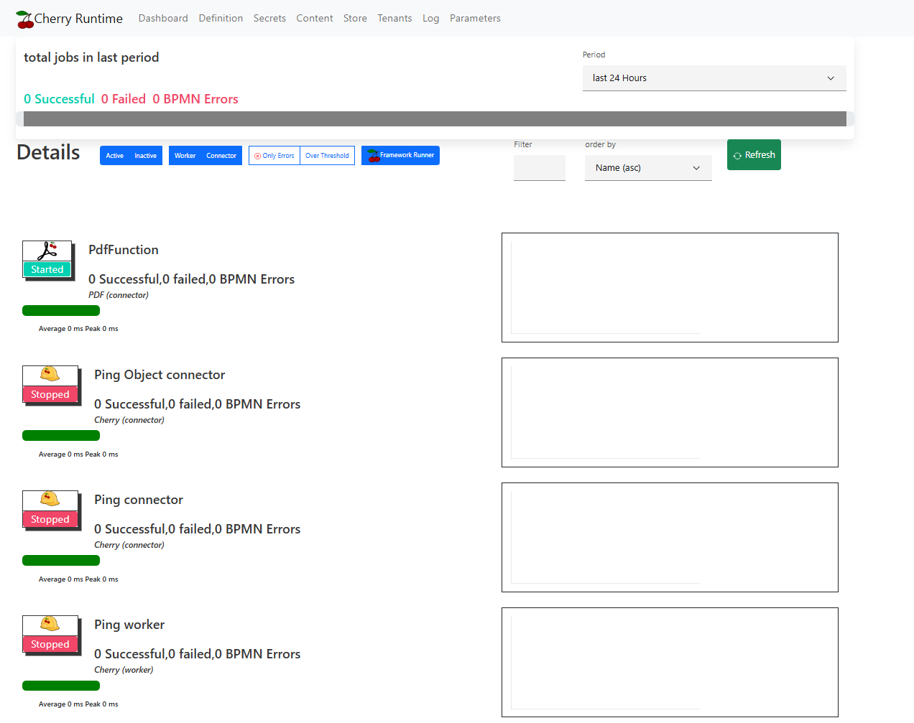

The Dashboard gives, for each runner, a view of its activity over a period:
* the state (Started / Stopped / Unknown), the logo and the name of the runner
* the number of successful executions, failed executions and BPMN errors
* the number of jobs waiting
* the average and peak execution time, and a chart of the executions
* an analysis tag, computed from the recent executions

Controls at the top of the page:
* **Filter**: keeps the runners whose name or type contains the text
* **Order by**: name, number of executions, or number of failures, ascending or descending
* **Period**: last 4 hours, last 24 hours, last week, last month
* the buttons next to the filter limit the list to workers, connectors, or runners not yet defined

If Cherry cannot read the number of waiting jobs of a runner from Camunda, the runner is displayed with a red
message that gives the reason (see [Troubleshooting](#troubleshooting)). The other information of the runner stays
visible.

## Runner detail

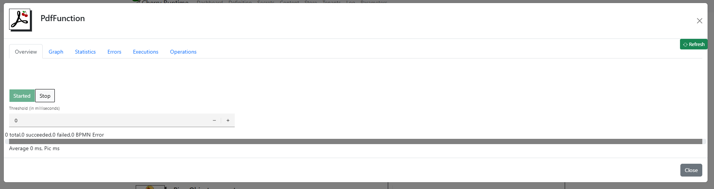

Click on a runner to open its detail. Tabs are:
* **Overview**: **Start** or **Stop** the runner, and set the *threshold* (in milliseconds) of the execution time
* **Graph**: executions and errors over time
* **Statistics**: executions, failures, BPMN errors, average and peak time
* **Errors**: the last failed executions, with the error code and the explanation
* **Executions**: the last executions
* **Operations**: the operations done on this runner (start, stop, ...)


# Jobs

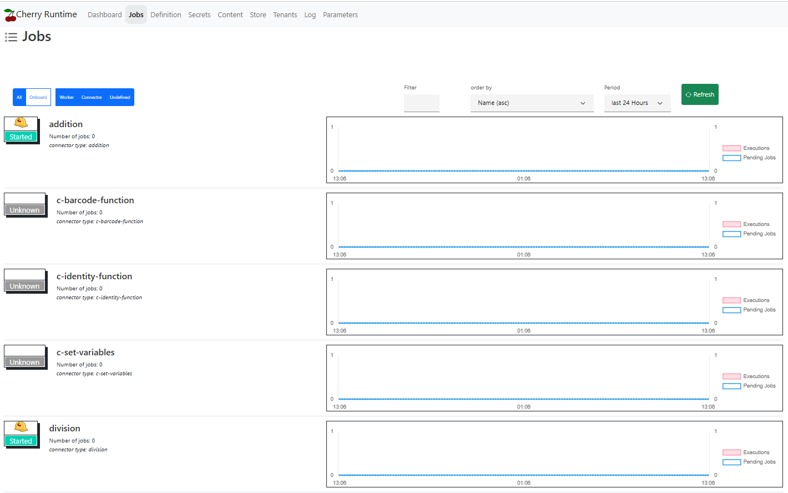

The Jobs page shows the **jobs waiting** in the engine, for each job type. It is used to see whether a connector
or a worker keeps up with the work it receives.

For each job type, the page shows the runner, its logo and state, **Number of jobs** (the jobs waiting), the connector
type, an analysis tag and a chart of the number of jobs waiting over the period.

A job is *waiting* when its state is `CREATED` in Camunda: it exists and no worker has completed it. The count is exact.
The Camunda REST API stops counting at 10 000 and Cherry counts above this limit; counting a very large backlog needs
one call to Camunda for each 1 000 jobs, so the page is slower when a job type has a large backlog.

Controls at the top of the page:
* **All / Onboard**: *Onboard* shows only the runners loaded in Cherry. *All* adds the connectors whose JAR was removed,
  and the job types that exist in the engine but that Cherry never loaded (state *UNREGISTERED*)
* **Worker / Connector / Undefined**: show or hide a category
* **Order by**: name, or number of jobs, ascending or descending
* **Period**: period of the chart

If Cherry cannot read the number of jobs for a type, the row displays a red message with the reason, and the number of
jobs is empty.

Cherry samples the number of waiting jobs in the background to build the chart. The settings are:

```yaml
cherry:
  runner:
    # Time between two samples
    refreshTopicsInMinutes: 5
    # true: one query collects the jobs of all types. false: one query per loaded runner
    refreshCollectAllTopics: true
```

A job type with many waiting jobs and no running runner usually means that the connector is stopped, not deployed, or
that it runs for another tenant.

# Definition

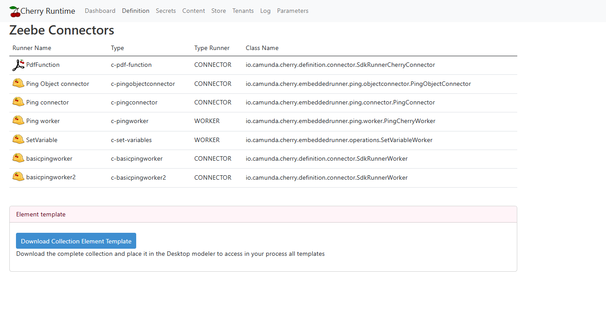

The Definition page lists every runner known by Cherry: **Runner Name**, **Type**, **Type Runner** (worker or connector)
and **Class Name**.

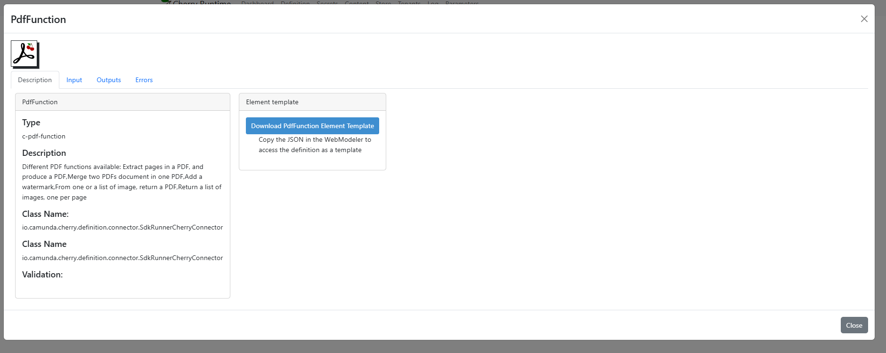

Click on a runner to see its documentation: inputs, outputs and BPMN errors, when the connector provides them.

The **Element template** of a runner, or the collection of all templates, can be downloaded and installed in the
Modeler to use the connector in a BPMN diagram.

# Secrets

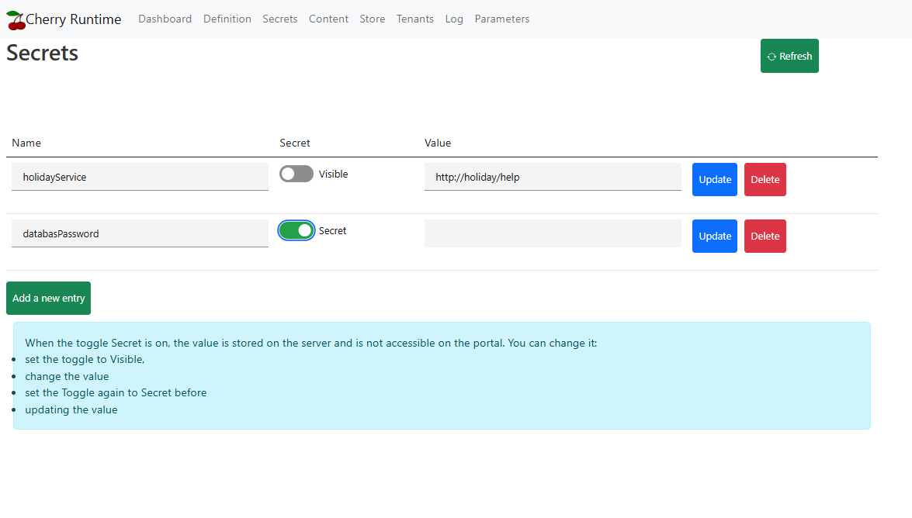

The Secrets page manages values saved in the Cherry database and given to the connectors.

* **Name**: the key of the value
* **Secret**: when selected, the value is a secret and is hidden on the screen
* **Value**: the value

Use **Add a new entry** to create a row, then **Update** to save it. **Delete** removes the row.

When the *Secret* toggle is on, the value is stored on the server and is not displayed in the console. To change it,
set the toggle to *Visible*, type the new value, and save.

A connector input uses a secret with the usual Camunda syntax, `{{secrets.<name>}}`: when the connector executes,
Cherry gives the value saved under this name.

# Content

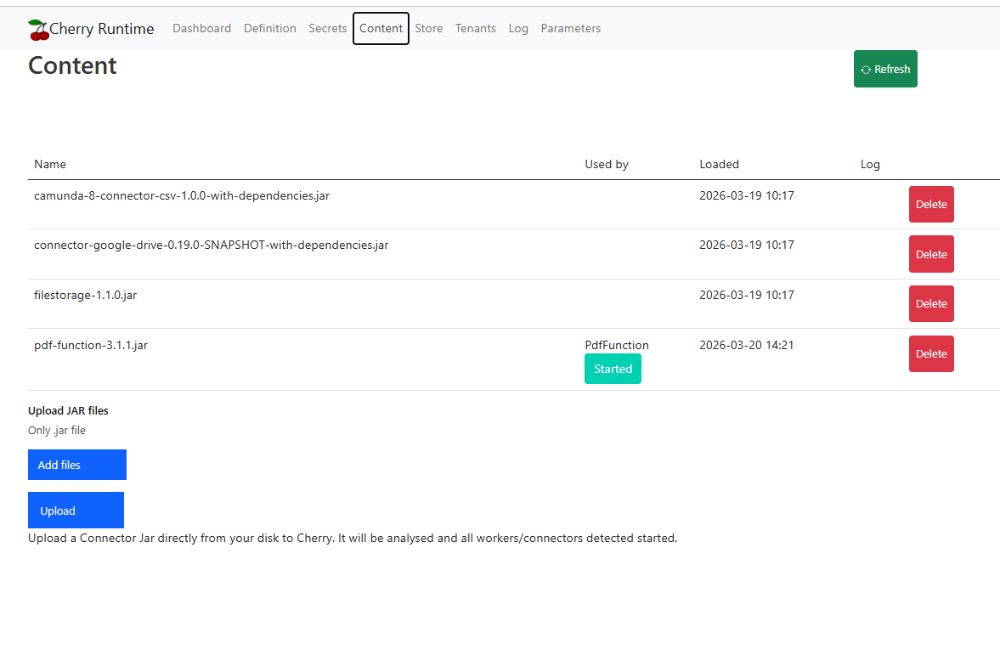

The Content page lists the JAR files saved in the Cherry database:
* **Name**: the file name, and the source of the JAR when known
* **Used by**: the runners found in this JAR
* **Loaded**: the date of the load
* **Log**: the log of the load of the JAR (the runners found, the errors)

**Upload a JAR**: choose a file in *File upload* and click **Upload**. Cherry analyses the JAR, saves it in the database
and starts all the connectors and workers found. The maximum size of a file is 500 MB
(`spring.servlet.multipart.max-file-size`).

**Delete** removes the JAR from Cherry.

Because the JAR is saved in the database, it survives a restart. Several pods sharing the same database load the same JARs.

# Store

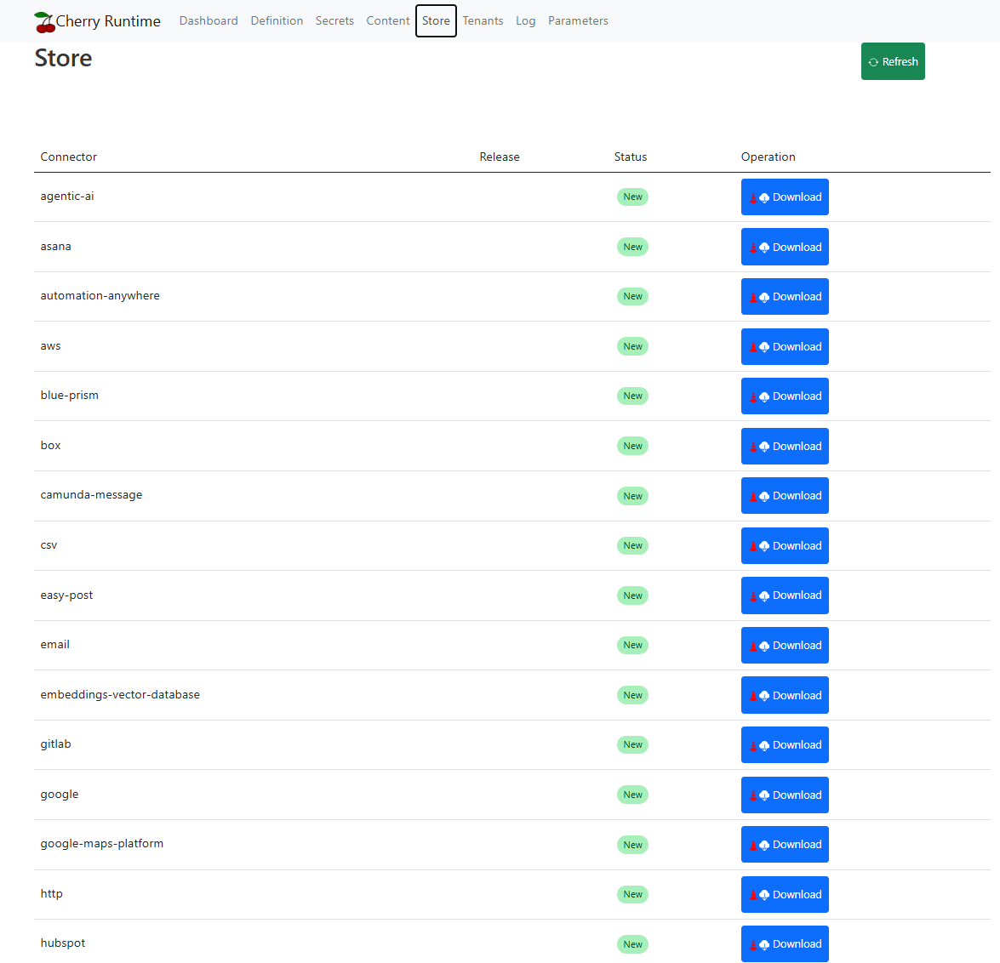

A store is a place that contains connectors and workers. The Store page lists what Cherry found in the stores
(Camunda connectors, Camunda Community Hub, Marketplace, private stores) and lets the administrator install a connector
with one click.

For each connector, the page shows its icon, its name, the store, the release, and a status:

| Status                | Meaning                                                      |
|-----------------------|--------------------------------------------------------------|
| Not installed         | The connector is available but not installed in Cherry.      |
| Up to date            | The installed release is the latest.                         |
| New                   | A more recent release is available.                          |
| No release            | The store does not publish a release.                        |
| In progress           | The installation is running.                                 |
| Install failed        | The last installation failed (see the Content page, Log).    |
| Exploration failed    | Cherry could not read the repository of this connector.      |
| No implementation     | The connector has no JAR of its own.                         |
| Parent not installed  | The connector relies on another connector, not installed.    |

Actions on a row: **Install**, download the **JAR**, download the **element template**, open the documentation.
Click on a row to see the details (annotations, description, creator).

**Explore again** forces Cherry to read the stores again. The exploration is done in the background: the list is
completed as the stores answer.

Stores are enabled and configured in the `cherry.store` section. See the [main README](../../README.md#store) for each
store and its credentials. In particular, GitHub limits anonymous calls to 60 per hour: set a `github.token` on the
stores you explore a lot, especially the Community hub.

# Tenants

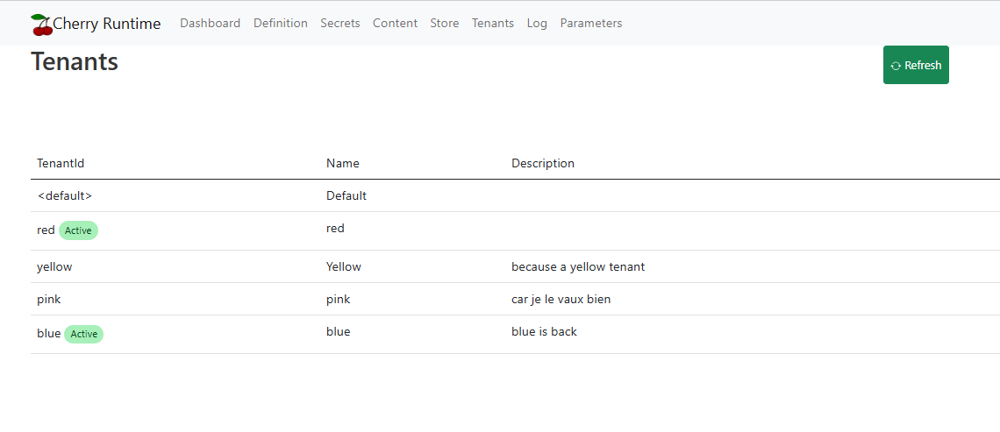

Cherry dynamically monitors the tenants and immediately adapts all runners (workers / connectors) to the new situation.

## New tenants
Cherry checks the tenant list every `refreshTenantsInMinutes` minutes. When a new tenant shows up, it verifies if the tenant is in the active list.
* if there is no active list, then the tenant is taken into account
* if the tenant is in the list, it is taken into account.

If the tenant must be used, then Cherry stops all runners, and restarts them using the new tenant list.

## Remove a tenant
The same method is used. If the active tenant list changes (no active list, or the tenant was in the active list), then all runners are stopped and restarted.

## Limit the tenants list
```yaml
cherry:
  tenants:
    refreshTenantsInMinutes: 1
    activeIds: blue,red

```
In the configuration, it is possible to limit the tenant list. Runners will then accept work only from this list.
If a tenant from the configuration list does not exist, then Cherry does not show that tenant in the list.

The tenant list is read from Camunda through its API, with the identity configured for Cherry. The identity must be
allowed to read tenants.

# Log

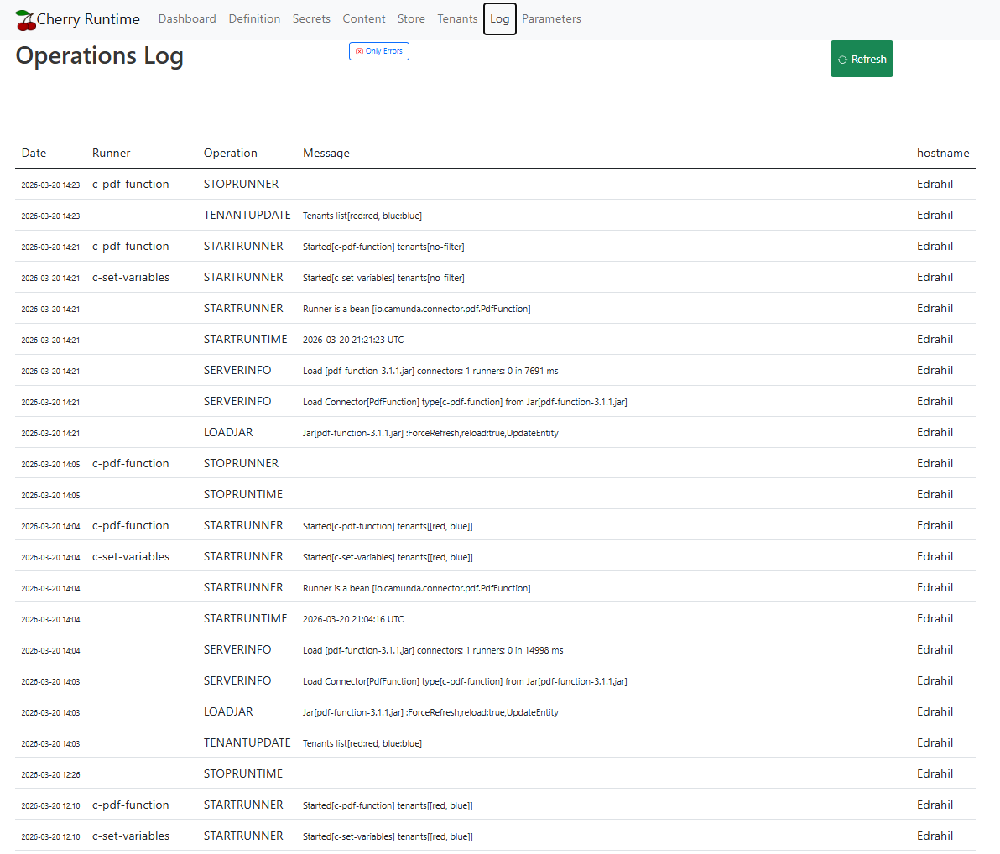

The Operations Log keeps the operations done on the runtime, by the administrators and by Cherry itself:
* **Date**
* **Runner**: the runner concerned, if any
* **Operation**
* **Message**: the details, for example the reason of a failure
* **hostname**: the pod that did the operation

Operations are: start and stop of a runner, change of threshold, start and stop of the runtime, load and removal of a
JAR, download of a JAR from a store, detection of a runner, update of the tenants, and errors.

In a farm, the log is shared: use the host name to find the pod.

# Parameters

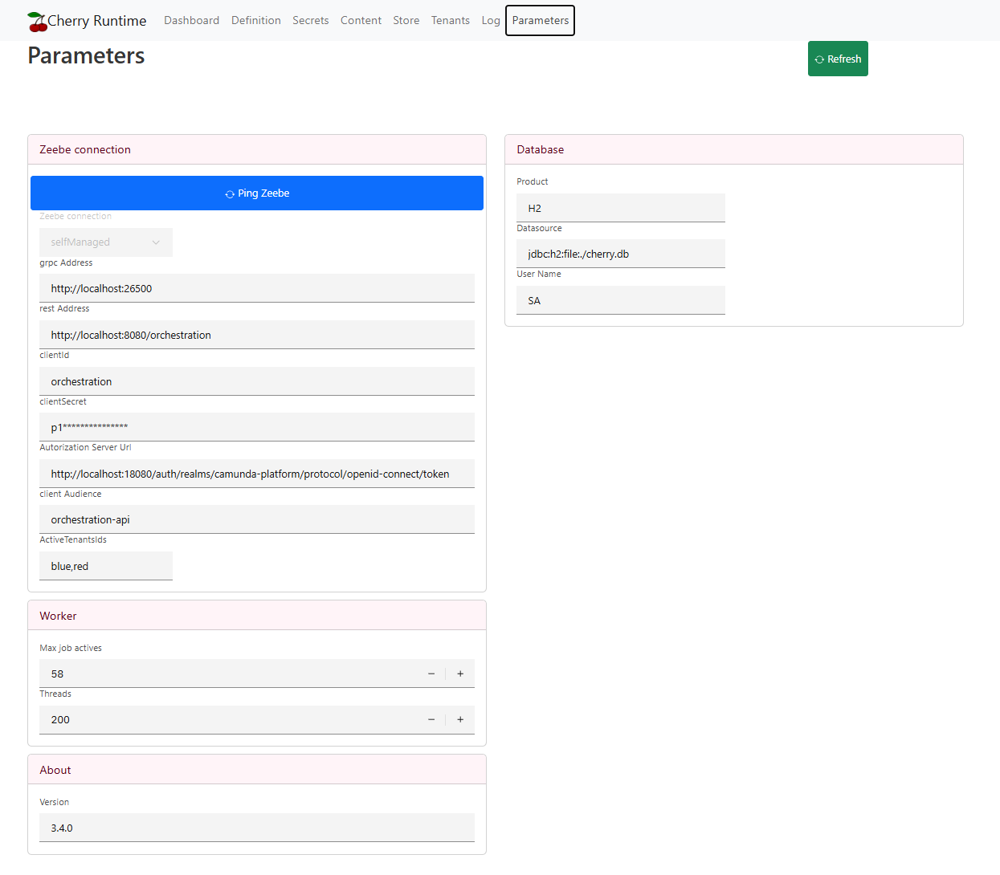

The Parameters page shows how Cherry is configured. It is read-only: change the values in the configuration
and restart Cherry.

* **Zeebe connection**: the connection mode (self-managed or SaaS), the gRPC and REST addresses or the SaaS cluster,
  the active tenants. The **Ping Zeebe** button checks the connection, and a tag tells whether Zeebe is
  *Up and running* or *Not available*.
* **About**: the version of Cherry
* **Database**: the product, the datasource and the user
* **Worker**: the maximum number of jobs activated at the same time (`camunda.client.worker.defaults.max-jobs-active`)
* **Stores**: each store, its type and whether it is *Active* or *Disabled*

This page is the first place to check when Cherry does not execute jobs.

# Configuration

Cherry is configured by the [application.yaml](../../src/main/resources/application.yaml) file, or by environment
variables (`CHERRY_STORE_PRIVATESTORE_ACCESS` for `cherry.store.privateStore.access`, `CAMUNDA_CLIENT_REST-ADDRESS` for
`camunda.client.rest-address`, ...).

## Connection to Camunda

```yaml
camunda:
  client:
    mode: self-managed
    auth:
      method: basic
      username: "demo"
      password: "demo"
    grpc-address: http://localhost:26500
    rest-address: http://localhost:8080
```

* `rest-address` is used by the workers and by the Cherry pages (jobs, tenants)
* `grpc-address` is used to activate the jobs
* for SaaS or Identity, see the [main README](../../README.md#configure-the-application)

If Cherry runs in a container, `localhost` is the container itself: use the name of the Camunda service
(`http://zeebe:8080`).

## Load connectors at startup

### Local disk

Any JAR file placed in the folder `cherry.connectorslib.uploadpath` (default `./localstorage/upload`) is installed
when Cherry starts. See [Folder upload](../../README.md#folder-upload).

```yaml
cherry:
  connectorslib:
    uploadpath: ./localstorage/upload
    classloaderpath: ./localstorage/classloader
```

`classloaderpath` is a work folder: Cherry writes the JARs saved in the database to this folder to load them, and clears
it at startup. Do not put your files in it.

The detection is done only at startup. A JAR added while Cherry is running is not seen until the next restart:
use the **Content** page to add a JAR to a running Cherry.

### Url

A JAR can be downloaded from a URL at startup, with the credentials of a store: see
[Direct download](../../README.md#direct-download).

```yaml
cherry:
  store:
    downloadStartup:
      - store: my-private-repo
        url: "https://github.com/<org>/<repo>"
```

## Marketplace

The Marketplace store lists the applications published on https://marketplace.camunda.com. Cherry can list them and
read their documentation and element templates, but downloading a connector from this store is not available yet.

```yaml
cherry:
  store:
    marketplaceConnector:
      access: true
```

## Private store

A private store is a GitHub account, organization or repository that Cherry explores like the Community hub. It is
the way to publish your own connectors to your runtimes. Each store can download its connectors at startup
(`downloadPolicy`: `NEVER`, `ALWAYS`, `UPDATE`, `FIXEDVERSION`, and a `filter`).
See [Private store](../../README.md#private-store).

# Cherry Database

Cherry saves in its database: the JAR files, the runners, the statistics of the executions, the number of jobs waiting,
the operations log and the secrets.

| Database           | Use                                                                                  |
|--------------------|--------------------------------------------------------------------------------------|
| H2 (default)       | A file `./cherry.db`. For one Cherry pod, a test, or a development. Lost with the pod if the file is not on a volume. |
| PostgreSQL         | For production, and for a farm of pods that share the same data.                     |

Use a SQL database to run several pods. See [docker-compose-cherry-postgres.yaml](../../docker/docker-compose-cherry-postgres.yaml).
The tables are created and updated by Cherry (`spring.jpa.hibernate.ddl-auto: update`): the database user needs the
right to create tables.

## Purge

Every hour, Cherry deletes the executions, operations and job counts older than `cherry.database.purgeRetentionDays`
(30 days by default). The JARs, the secrets and the stores are not purged.

```yaml
cherry:
  database:
    purgeRetentionDays: 30
```

A long retention gives longer charts but increases the size of the database.

# Troubleshooting

| Symptom                                                                 | Check                                                                                                     |
|-------------------------------------------------------------------------|-----------------------------------------------------------------------------------------------------------|
| Parameters page: Zeebe *Not available*                                  | `grpc-address`, `rest-address`, credentials. Test the address from the machine that runs Cherry.          |
| Red message `Can't access http://.../v2/jobs/search: ...ConnectException` on the Dashboard or Jobs page | Cherry cannot reach the REST API of Camunda. Check `camunda.client.rest-address`, and that the port is open from Cherry (see below). |
| Jobs waiting for a type, but nothing executes                           | The runner is stopped, not deployed (*Unknown*), or the tenant of the process is not an active tenant.    |
| A connector does not appear in the Store                                | The store is *Disabled* (Parameters page), a `filter` excludes it, or the GitHub limit is reached (add a token). |
| An uploaded JAR is not loaded                                           | Check the **Log** column in the Content page.                                                             |

## The REST address works with `curl` but not from Cherry

`localhost` can be resolved to several addresses: `127.0.0.1` (IPv4) and `::1` (IPv6). `curl` and browsers try them
one after the other. A forwarder such as the WSL port relay used by Docker Desktop on Windows may listen on `::1` only:
`curl http://localhost:8080` works, but a client that only tries `127.0.0.1` gets a *connection refused*.

* Check what listens: `netstat -ano | findstr :8080`. A line `[::1]:8080` without a `127.0.0.1:8080` line confirms it.
* Use the address that listens: `rest-address: http://[::1]:8080`.

Prefer this address only in your local configuration. In a shared configuration, keep `localhost` or the service name.
