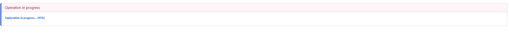

# Introduction
This directory contains a help deployment to deploy Cherry runtime on 2 pods, using a Postgres database.


# Deployment
Check the deployment file, and adapt it.

## Replica
the replica is set to 2 by default, multiple can be set

## Shared folder
A shared folder is created. Connectors can be deployed in this folder, to be uploaded.

## Database
A Postgres database is used. it can be replaced by a different database, or an H2 (then each pod will have it's local database)

## Connection to Zeebe
The deployment must be run in the same cluster as Zeebe. If it is a different cluster, then the zeebe connection must be adapted

# Operation

```shell
kubectl create -f cherry-runtime-postgres.yaml
```

Forward the Cherry runtime access 

```shell
kubectl port-forward svc/cherry-runtime-service 9081:9081 -n camunda
```

# Remove Cherry

```shell
kubectl delete -f cherry-runtime-postgres.yaml
```

Postgres create a PVC, and it must be removed manually via


# Store

Cherry can access up to four different stores to collect the list of connectors/workers you can
install: the official `CamundaConnector` store, the `CommunityConnector` store ("Camunda Community
Hub"), the `MarketplaceConnector` store, and your own `PrivateStore`.



## Exploration

Clicking "Explore again" on the Store page (or hitting it automatically at startup) kicks off a
background exploration of every enabled store, in three passes:
1. **List** every repository/connector each enabled store can see (for `CommunityConnector`, this
   means paginating through the entire `camunda-community-hub` GitHub org).
2. **Deep-explore** each one found in pass 1 - checking for an element-template, a `pom.xml`, and a
   GitHub release, to qualify it and locate its downloadable JAR.
3. **Compute** which connectors are installable (JAR found, or a sibling connector shares the same
   type and already has one).

This runs on a background thread, so it doesn't block the UI - the "Operation in progress" card
(shown on Dashboard, Jobs, Content and Store) polls progress and shows a percentage while it's
running, and disappears once it completes. It can genuinely take several minutes, mostly on pass 2
for `CommunityConnector` (one to three GitHub API calls per repository, for potentially hundreds of
repositories) - this is normal, not a hang.

## GitHub rate limiting

Every store but `PrivateStore`'s underlying repos talks to the public GitHub API, which is rate
limited two different ways:
- **Hourly quota**: 60 requests/hour unauthenticated, 5000/hour with a token. `CommunityConnector`
  in particular can burn through the unauthenticated quota in a single exploration pass, so it's
  strongly recommended to set a GitHub token for every store you enable - see the subtlety section
  below for exactly which variable to set per store, and where to generate one.
- **Secondary/abuse-detection limit** (HTTP 429): a short burst limiter, independent of the hourly
  quota, that can trigger from exploring (or re-exploring) too many repositories in quick
  succession - including from clicking "Explore again" repeatedly in a short window. Cherry retries
  automatically on a 429, honouring GitHub's `Retry-After` header (up to a couple of retries), so a
  transient burst recovers on its own; a token does not prevent this one, only the hourly quota.

## Disabling a store

It is possible to disable any store entirely via these variables:
```
- name: CHERRY_STORE_PRIVATESTORE_ACCESS
  value: "false"
- name: CHERRY_STORE_CAMUNDACONNECTOR_ACCESS
  value: "false"
- name: CHERRY_STORE_COMMUNITYCONNECTOR_ACCESS
  value: "false"
- name: CHERRY_STORE_MARKETPLACECONNECTOR_ACCESS
  value: "false"
```

## A subtlety: each store has its own, independent GitHub connection

Cherry talks to four stores, each configured under `cherry.store.<storeName>` (env prefix
`CHERRY_STORE_<STORENAME>_...`):

| `<storeName>` env segment | Display name in the UI       | GitHub repo it reads                          |
|---------------------------|-------------------------------|------------------------------------------------|
| `CAMUNDACONNECTOR`        | "Camunda Connector"           | `github.com/camunda/connectors`                 |
| `COMMUNITYCONNECTOR`      | "Camunda Community Hub"       | `github.com/orgs/camunda-community-hub`         |
| `MARKETPLACECONNECTOR`    | the Camunda Marketplace       | (per-connector, via marketplace.camunda.com)    |
| `PRIVATESTORE`            | your own private store(s)     | whatever URL you configure, see below           |

**Trap:** the "Hub" branding belongs to `COMMUNITYCONNECTOR` ("Camunda Community Hub"), not to
`CAMUNDACONNECTOR`. There is no `CAMUNDAHUB` property anywhere — `CHERRY_STORE_CAMUNDAHUB_...`
does not match any field and is silently ignored by Spring Boot's relaxed binding (no error, the
property just keeps its default). If you mean the "Hub", use `CHERRY_STORE_COMMUNITYCONNECTOR_...`.

Each of these four stores builds its **own, independent** `GitHubAccess` instance, carrying its
**own** token - there is no shared/pooled GitHub connection and no fallback from one store to
another (see `StoreFactory`'s constructor, which does `new GitHubAccess(...)` once per store,
and once more per `privateStore` entry). Concretely:
- `CAMUNDACONNECTOR`'s GitHub calls use only `CHERRY_STORE_CAMUNDACONNECTOR_GITHUB_TOKEN`.
- `COMMUNITYCONNECTOR`'s GitHub calls use only `CHERRY_STORE_COMMUNITYCONNECTOR_GITHUB_TOKEN`.
- `MARKETPLACECONNECTOR`'s GitHub calls use only `CHERRY_STORE_MARKETPLACECONNECTOR_GITHUB_TOKEN`.
- each `privateStore` entry (`listStores[N]`) uses only its own `...LISTSTORES_N_GITHUB_TOKEN`.

Leaving a token unset does not break that store - it just falls back to an **unauthenticated**
GitHub call for that store specifically, nothing more.

**It is strongly recommended to set a token for every store you enable.** GitHub's REST API
rate-limits unauthenticated calls to 60 requests/hour per source IP, versus 5000 requests/hour
once authenticated - and `COMMUNITYCONNECTOR` in particular walks an entire GitHub org
(`camunda-community-hub`) one repository at a time, so it can burn through the unauthenticated
quota in a single discovery pass, after which that store simply stops finding connectors until
the hour resets (no crash, just an increasingly empty/stale connector list). Any plain GitHub
personal access token works - it only needs read access to public repositories, no scopes
required: generate one at https://github.com/settings/tokens and set it as the relevant
`..._GITHUB_TOKEN` variable above.

## Private store

A private store points Cherry at your own GitHub user/org to discover and download connectors
from, instead of (or in addition to) the three built-in stores above. Unlike those, a private
store is a **list** (`listStores`), so each entry is addressed by its index (`0`, `1`, ...) in
the env var name.

Example, matching this private store entry from `application-private.yaml`:
```yaml
cherry:
  store:
    privateStore:
      access: true
      listStores:
        - name: pierre-yves
          url: https://github.com/pierre-yves-monnet
          github:
            token: ""
            apikey: ""
          tokenHeaderName: "Authorization"
          tokenPrefix: "Bearer "
          apikeyHeaderName: ""
          startup:
            downloadPolicy: ALWAYS
            filter:
              - "C8-MathWorker"
```

The equivalent list of env vars to declare in the k8s manifest:
```yaml
- name: CHERRY_STORE_PRIVATESTORE_ACCESS
  value: "true"
# --- entry 0: "pierre-yves" ---
- name: CHERRY_STORE_PRIVATESTORE_LISTSTORES_0_NAME
  value: "pierre-yves"
- name: CHERRY_STORE_PRIVATESTORE_LISTSTORES_0_URL
  value: "https://github.com/pierre-yves-monnet"
# GitHub token for *this store only* - used both to list/read this GitHub user/org
# (element-templates, releases) and, unless overridden below, as the Maven provider credential
# used to download the JAR itself. Strongly recommended, see "subtlety" section above.
- name: CHERRY_STORE_PRIVATESTORE_LISTSTORES_0_GITHUB_TOKEN
  value: "<your-github-token>"
- name: CHERRY_STORE_PRIVATESTORE_LISTSTORES_0_GITHUB_APIKEY
  value: ""
# Override the header name/prefix/apikey-header used to send the credential above when
# downloading the JAR from this store's artifact provider - leave blank to keep the defaults.
- name: CHERRY_STORE_PRIVATESTORE_LISTSTORES_0_TOKENHEADERNAME
  value: "Authorization"
- name: CHERRY_STORE_PRIVATESTORE_LISTSTORES_0_TOKENPREFIX
  value: "Bearer "
- name: CHERRY_STORE_PRIVATESTORE_LISTSTORES_0_APIKEYHEADERNAME
  value: ""
# NEVER / ALWAYS / UPDATE / FIXEDVERSION - whether/when to auto-download matching connectors
# at startup, and which job types to restrict that to (supports wildcards).
- name: CHERRY_STORE_PRIVATESTORE_LISTSTORES_0_STARTUP_DOWNLOADPOLICY
  value: "ALWAYS"
- name: CHERRY_STORE_PRIVATESTORE_LISTSTORES_0_STARTUP_FILTER_0
  value: "C8-MathWorker"
```

To declare a second private store, add a second block using `LISTSTORES_1_...` instead of
`LISTSTORES_0_...`, and so on.

**This token is a secret.** As with the built-in stores, don't leave it as plaintext in a
manifest you intend to commit - wire it through a Kubernetes `Secret` and `secretKeyRef` instead.
